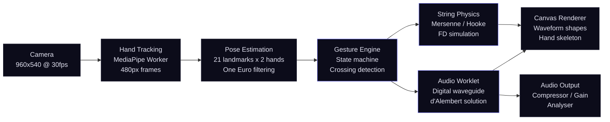

<div align="center">

# VIRTUO

**Gesture-controlled virtual string instrument**

Create strings in the air. Play them with your hands.

Physics-driven sound from gesture alone — no MIDI, no keyboard, no touchscreen.

<br>

[](https://nextjs.org)
[](https://react.dev)
[](https://typescriptlang.org)
[](https://ai.google.dev/edge/mediapipe/solutions/vision/hand_landmarker)
[](#testing)

</div>

<br>

## What is VIRTUO?

VIRTUO is a browser-based musical instrument where your hands are the interface. A webcam captures hand movement, MediaPipe tracks 21 landmarks per hand in real time, and gesture logic translates that into physical string interactions — creation, plucking, strumming, bending, sliding, tremolo and muting.

Each string is a bidirectional digital waveguide running at audio sample rate inside an AudioWorklet. The pitch follows Mersenne's law, bending uses Hooke's law for tension increase, and the same delay-line state that produces sound is sampled to draw the vibrating string on screen.

There is no pre-recorded audio. Every sound is synthesised from the physics of the interaction at the moment it happens.

<br>

## Visual Showcase

> **Screenshots not yet captured.** The sections below describe what each view shows. To complete this section, the following assets would be useful:
>
> | Asset | Description | Suggested filename |
> |---|---|---|
> | Landing hero | The opening section with animated string geometry and mathematical typography | `docs/screenshots/hero.png` |
> | Instrument — Freehand | The instrument canvas with hand-drawn strings, hand skeleton overlay and gesture feed | `docs/screenshots/freehand.png` |
> | Instrument — Studio | Studio mode with Guitar preset strings laid out horizontally | `docs/screenshots/studio.png` |
> | Hand tracking | The camera view showing hand landmark tracking and pinch detection meter | `docs/screenshots/tracking.png` |
> | Physics section | The landing page physics scene with interactive sliders for tension, length and density | `docs/screenshots/physics.png` |

<br>

## Core Capabilities

| Capability | Description |
|:---|:---|
| **Real-time hand tracking** | MediaPipe HandLandmarker (21 landmarks per hand, up to 2 hands) running in a Web Worker with GPU acceleration. One Euro filters smooth the tracking while preserving fast gestures. |
| **String creation** | Pinch and pull apart in the air to draw a string between two points. Two-hand creation supported: each hand defines one endpoint. |
| **Plucking** | Flick a finger across a string. Amplitude scales with hand speed. |
| **Strumming** | Sweep across multiple strings in one motion. Multi-string detection with per-string cooldown and side-based re-arming. |
| **Stopping and sliding** | Pinch a string to shorten its vibrating length, changing the pitch. Slide along it to glide between notes. |
| **Bending** | While stopped, pull the string sideways. Tension increases via Hooke's law, raising the pitch continuously. |
| **Tremolo** | Rapidly alternate a finger back and forth across a single string. |
| **Muting** | Open palm near a string damps it immediately. |
| **Freehand mode** | Draw strings anywhere at any angle. Length determines pitch. Optional semitone snapping. Up to 12 simultaneous strings. |
| **Studio mode** | Pre-tuned string layouts: Guitar (EADGBE), Bass (EADG), Harp (C pentatonic, 8 strings). |
| **Physical audio synthesis** | Bidirectional digital waveguide in an AudioWorklet — no samples, no oscillators. Each string is a pair of delay lines with inverting reflections and a one-pole loss filter. |
| **Mouse / touch fallback** | Full interaction via pointer input when no camera is available. Click = pinch, drag to draw, move across to pluck. |

<br>

## How It Works



**Pipeline at a glance:**

1. **Camera** delivers frames at up to 30 fps.
2. **Web Worker** runs MediaPipe HandLandmarker on resized 480px bitmaps (GPU delegate preferred, CPU fallback). Inference runs at approximately 10–12 fps.
3. **Pose estimation** extracts 21 landmarks per hand, applies One Euro filtering (minCutoff 1.5, beta 0.03), computes pinch ratio with calibrated hysteresis thresholds.
4. **Gesture engine** classifies intent through a state machine: idle, pending-create, create, or strumming. Segment intersection detects crossings between fingertip trajectories and string vibrating segments.
5. **String physics** computes fundamental frequency via Mersenne's law, applies Hooke-law tension for bends, and runs a finite-difference simulation for visual fallback.
6. **AudioWorklet** synthesises each string as a bidirectional digital waveguide at audio sample rate. The same delay-line displacement is posted back to the main thread at ~60 Hz for rendering.
7. **Canvas** draws string waveforms, hand skeletons, pinch meters and gesture labels at display refresh rate.

<br>

## Physics and Mathematics

VIRTUO's sound and behaviour are rooted in the physics of vibrating strings.

### Fundamental frequency — Mersenne's law

$$f_0 = \frac{1}{2L}\sqrt{\frac{T}{\mu}}$$

| Symbol | Meaning | Unit |
|:---:|:---|:---|
| *f*&#8320; | Fundamental frequency | Hz |
| *L* | Vibrating string length | m |
| *T* | Tension | N |
| *&mu;* | Linear mass density | kg/m |

The pitch of each string follows directly from its physical length on screen (mapped to metres via a stage scale of 1.2 m across the viewport width), its tension and its mass density. Sliding a finger along a stopped string shortens the vibrating length, raising the pitch. Moving an endpoint changes the total length.

### Bending — Hooke's law tension increase

$$T_{\text{bent}} = T + EA \cdot \frac{\Delta L}{L}$$

Pulling a stopped string sideways stretches it. The tension increase is proportional to the elongation, with the stretch ratio *EA/T* set to 140 (typical of steel strings). Tension is capped at 2x the open-string value to prevent unrealistic behaviour.

### Digital waveguide — d'Alembert's solution

The 1-D wave equation has the general solution:

$$y(x, t) = R(x - ct) + L(x + ct)$$

Two travelling waves — *R* moving toward the bridge, *L* toward the nut — are stored as circular delay lines. At each end, the wave inverts (fixed boundary). At the bridge, a one-pole low-pass filter removes high-frequency energy on each reflection, producing the natural darkening of a decaying string tone.

The round-trip delay sets the pitch: `delay = sampleRate / f₀`, with fractional-sample interpolation for tuning accuracy. The same delay-line state is sampled at 33 points and posted to the main thread for drawing — the visual string shape is literally the audio waveform.

### Mode amplitudes

Plucking at position *p* along the string excites harmonics with amplitudes:

$$A_n = \frac{2}{n^2 \pi^2 p(1-p)} \sin(n\pi p)$$

Plucking at the midpoint silences all even harmonics. Plucking near the bridge emphasises higher overtones, producing a brighter tone.

<br>

## Gesture Reference

| Gesture | How to perform | What happens | Notes |
|:---|:---|:---|:---|
| **Create** | Pinch thumb and index finger, hold briefly, then pull apart | Draws a new string between the start and end positions | Requires a sustained pinch (~120 ms for camera input). Blocked during active strumming. |
| **Two-hand create** | Both hands pinch within 500 ms of each other | Each hand defines one endpoint of the string | Camera hands only |
| **Pluck** | Flick index finger across a string | Excites the string at the crossing point | Amplitude proportional to hand speed |
| **Strum** | Sweep hand across multiple strings | Plucks each string crossed in sequence | Middle fingertip also tested for wider coverage |
| **Stop** | Pinch directly on a string body | Shortens the vibrating length from that point | Fret position shown in HUD |
| **Slide** | While stopped, move along the string | Glides pitch continuously | Event after moving > 2 cm |
| **Bend** | While stopped, pull sideways | Raises pitch via increased tension | 6 px deadzone before engaging |
| **Tremolo** | Rapidly alternate finger across one string | Detected after 2+ direction alternations within 600 ms | Throttled to 400 ms between events |
| **Mute** | Open palm near a string | Damps the string to silence | All four fingers must be extended |
| **Grab endpoint** | Pinch near an endpoint of a non-fixed string | Drag to reposition, changing length and pitch | Freehand mode only |

<br>

## Technology Stack

| Layer | Technology | Role |
|:---|:---|:---|
| **Framework** | Next.js 16.4.6 (Turbopack, App Router) | Server components, routing, bundling |
| **UI** | React 19.3, TypeScript (strict) | Component model and type safety |
| **Styling** | Tailwind CSS 4.3 | Utility-first styling with custom design tokens |
| **Hand tracking** | MediaPipe Tasks-Vision 1.2.3 | 21-landmark hand pose estimation (GPU / CPU) |
| **Signal filtering** | One Euro Filter | Landmark smoothing with speed-adaptive cutoff |
| **Physics** | Custom (Mersenne, Hooke, finite-difference) | String frequency, tension, visual simulation |
| **Audio synthesis** | AudioWorklet (digital waveguide) | Real-time physical string synthesis at sample rate |
| **Animation** | GSAP 3.15 + ScrollTrigger + SplitText | Scroll-driven animations on the landing page |
| **Smooth scroll** | Lenis 1.3 | Inertia scrolling synchronised with GSAP |
| **Canvas** | 2D Canvas API | String waveforms, hand overlays, gesture visualisation |
| **Testing** | Node.js built-in test runner | Physics, waveguide tuning and gesture logic tests |

<br>

## Project Structure

```
virtuo-app/
├── app/
│   ├── layout.tsx                 # Root layout: fonts, metadata, viewport
│   ├── page.tsx                   # Landing page: 7 scroll-driven sections
│   ├── globals.css                # Design tokens, component styles, reduced-motion query
│   └── instrument/
│       └── page.tsx               # Full-screen playable instrument
│
├── components/
│   ├── Hero.tsx … CTA.tsx         # Landing page sections (7)
│   ├── Navbar.tsx                 # Navigation with mobile menu and sound toggle
│   ├── ErrorBoundary.tsx          # Catch-all error boundary
│   ├── instrument/
│   │   ├── InstrumentApp.tsx      # Camera, calibration, render loop, pointer input
│   │   └── Hud.tsx                # Controls: mode, preset, snap, sustain, volume, gesture feed
│   └── site/
│       ├── Stage.tsx              # Fixed canvas: 6 strands × 96 points, scene blending
│       ├── Choreography.tsx       # GSAP ScrollTrigger timeline for all sections
│       └── SmoothScroll.tsx       # Lenis integration with GSAP ticker
│
├── lib/
│   ├── geometry.ts                # Vec, dist, lerp, smoothstep, segmentIntersect, project, splines
│   ├── anim/gsap.ts              # GSAP registration (ScrollTrigger, SplitText)
│   ├── audio/AudioEngine.ts      # Singleton: AudioContext → Worklet → compressor → output
│   ├── instrument/
│   │   ├── InstrumentController.ts # Gesture state machine, string management, physics
│   │   ├── presets.ts             # Guitar, Bass, Harp (frequencies, densities, brightness)
│   │   └── render.ts             # Canvas: waveforms, hand skeleton, pinch meter
│   ├── physics/string.ts         # Mersenne, Hooke, mode amplitudes, FD string, note naming
│   ├── tracking/
│   │   ├── hand.ts               # HandPose, pinch hysteresis, poseFromLandmarks
│   │   ├── HandTracker.ts        # Camera, Worker lifecycle, One Euro filtering
│   │   ├── hand.worker.ts        # MediaPipe inference off main thread
│   │   ├── calibration.ts        # Two-step pinch calibration (open → pinch)
│   │   └── oneEuro.ts            # One Euro filter implementation
│   └── site/
│       ├── store.ts              # Mutable landing-page state
│       ├── scenes.ts             # 7 scene definitions with strand geometry
│       └── scroll.ts             # Lenis instance and scrollToId
│
├── public/worklets/
│   └── virtuo-string-processor.js  # AudioWorklet: WaveguideString, multi-voice processor
│
├── scripts/
│   └── setup-mediapipe.mjs       # Postinstall: copies WASM + downloads hand model
│
└── tests/
    ├── physics.test.ts           # 9 tests: Mersenne, bend, modes, notes, FD, intersection, pinch
    ├── waveguide.test.mjs        # 10 tests: tuning accuracy, decay, mute, glide
    └── gesture.test.ts           # 7 tests: crossing, speed gate, side re-arm, creation guards
```

<br>

## Installation

### Prerequisites

- **Node.js** 20 or later
- **npm** 9 or later
- A browser with **WebRTC** (camera) and **AudioWorklet** support — Chrome, Edge or Firefox
- A webcam (optional — mouse / touch works without one)

### Setup

```bash
# Clone the repository
git clone <repository-url>
cd virtuo-app

# Install dependencies
# (postinstall copies MediaPipe WASM and downloads the 7.5 MB hand landmark model)
npm install

# Start the development server
npm run dev
```

The app opens at **http://localhost:3000**.

If the postinstall model download fails (network issues), hand tracking will not work but the rest of the app functions normally. Re-run `node scripts/setup-mediapipe.mjs` to retry.

### Available scripts

| Command | Description |
|:---|:---|
| `npm run dev` | Development server (Turbopack) |
| `npm run build` | Production build |
| `npm start` | Serve production build |
| `npm test` | Run all 26 tests |
| `npm run typecheck` | TypeScript strict check |
| `npm run lint` | ESLint |

<br>

## How to Use VIRTUO

### Landing page — `/`

A scroll-driven experience with seven sections — Hero, Concept, Physics, Gesture, Instrument, Sound and CTA — each with continuous mathematical string geometry on a fixed canvas. Interactive controls in the Physics section let you adjust tension, length and density in real time.

### Instrument — `/instrument`

1. **Choose input** — "Start with camera" for hand tracking, or "Mouse / touch only" for pointer input.
2. **Calibrate** (camera only) — hold your hand open, then pinch. This measures your pinch range for accurate detection. You can skip to use defaults.
3. **Create strings** — in Freehand mode, pinch and pull apart to draw a string. In Studio mode, strings are pre-laid out by preset.
4. **Play** — flick your finger across a string to pluck it. Sweep across several to strum.
5. **Stop and slide** — pinch a string to stop it, slide along it to change pitch, pull sideways to bend.
6. **Mute** — open your palm near a string to damp it.
7. **Explore** — switch between Freehand and Studio in the top bar. Studio offers Guitar, Bass and Harp presets. Toggle semitone snapping, adjust sustain and volume.

### Keyboard shortcuts

| Key | Action |
|:---|:---|
| `Space` | Strum all strings |
| `Delete` / `Backspace` | Remove last created string |
| `Shift` (hold) | Open palm mute (pointer mode) |

<br>

## Testing

```bash
npm test
```

**26 tests** across three suites, all passing:

| Suite | Tests | Coverage |
|:---|:---:|:---|
| `physics.test.ts` | 9 | Mersenne's law, bending, mode amplitudes, note naming, FD string, segment intersection, projection, pinch hysteresis, open palm detection |
| `waveguide.test.mjs` | 10 | Tuning accuracy within 6 cents across 82–988 Hz, bounded decay, mute damping, pitch glide, fixed boundary conditions |
| `gesture.test.ts` | 7 | Multi-string crossing, speed gate thresholds, side-based re-arm, creation hold guard, pointer immediacy, middle-finger coverage, strum-recency blocking |

Additional verification:

```bash
npm run typecheck   # TypeScript strict — zero errors
npm run lint        # ESLint — zero warnings
npm run build       # Production build — compiles successfully
```

<br>

## Known Limitations

| Area | Limitation |
|:---|:---|
| **Tracking frame rate** | MediaPipe inference runs at ~10–12 fps on the tested hardware. Gestures faster than ~600 BPM cannot be reliably distinguished. |
| **Browser support** | Requires AudioWorklet and getUserMedia. Tested in Chrome and Edge on Windows. Firefox AudioWorklet support varies. Safari requires version 14.1 or later. |
| **Single machine tested** | Performance figures are from one machine with an integrated GPU. Results will vary. |
| **No mobile camera tracking** | The landing page and pointer input work on mobile. Camera hand tracking has not been tested on mobile browsers. |
| **Lighting sensitivity** | Hand detection accuracy depends on lighting and background contrast. |
| **Audio latency** | AudioWorklet adds one block (128 samples, ~2.7 ms at 48 kHz) of inherent latency. Total gesture-to-sound latency includes the tracking frame interval. |
| **No persistence** | Strings and instrument state are not saved between sessions. Only calibration data is stored in localStorage. |

<br>

## Future Development

Genuine opportunities based on the current implementation — not committed features.

- **MIDI output** — map string interactions to MIDI messages for use with external synthesisers
- **Recording and playback** — capture gesture sequences and replay them
- **Custom tunings** — user-defined string layouts and tuning systems
- **Multi-device sessions** — WebRTC-based shared instrument
- **Mobile hand tracking** — test and optimise MediaPipe on mobile GPUs
- **Alternative input** — gamepad or switch input for accessibility
- **PWA support** — offline capability, since all processing is local

<br>

## Architecture Notes

- **No external audio.** All sound comes from waveguide delay lines in the AudioWorklet. No samples, no oscillators, no Web Audio API oscillator nodes.
- **Worker-based tracking.** MediaPipe runs in a dedicated Web Worker. Frames are sent as transferable `ImageBitmap` objects resized to 480px to avoid blocking rendering.
- **Gesture state machine.** Each hand has an independent state: idle → pending-create → create, or idle → plucking/strumming. Mutual exclusion prevents strumming from accidentally triggering creation.
- **Calibration-aware thresholds.** Pinch detection uses per-user calibrated thresholds with hysteresis (enter ≠ exit) to prevent flickering.
- **Visual = audio.** The AudioWorklet posts delay-line displacement shapes to the main thread. The canvas draws these directly — the visible waveform is the actual audio waveform.

<br>

## Design Tokens

| Token | Value | Usage |
|:---:|:---:|:---|
| `--bg` | `#04040a` | Page background |
| `--surface` | `#0c0c1a` | Panel backgrounds |
| `--border` | `#1c1c30` | Borders and dividers |
| `--text-1` | `#e2e2f0` | Primary text |
| `--text-2` | `#9a9ac4` | Secondary text |
| `--accent` | `#8080ff` | Interactive elements |

Typography: **Space Grotesk** (body) · **JetBrains Mono** (code and labels)

<br>

---

<div align="center">

**VIRTUO**

*Your hands are the instrument.*

</div>
# Virtuo

